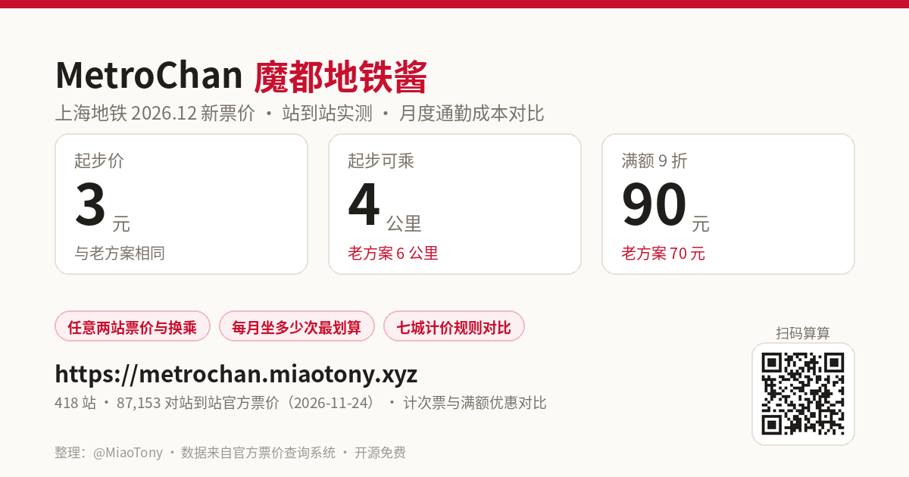

# MetroChan 魔都地铁酱

上海地铁票价对比工具 · 老方案（2005 版）vs 新方案（2026-12-01 起执行），附听证方案一、二与八城横向对比



🚇 **在线访问：<https://metrochan.miaotony.xyz/>**

开发使用 Node 24：`npm ci` 安装依赖，`npm run dev` 启动热更新。`npm run build` 从同一套 TypeScript 源码生成两个产物：

- **网站**：发布 `dist/`，`npm run preview` 可本地预览。官方路径按需加载，不随首屏打包。只要网站时运行 `npm run build:web`。
- **离线文件**：将 `release/MetroChan-offline.html` 单独复制到其他电脑，用浏览器打开即可。地图、官方路径、图片和二维码都内置，无需启动服务。分享链接指向在线版，而不是本机文件地址。只做离线版时运行 `npm run build:offline`。

不要直接托管源码。Cloudflare 主站和 Pages 备用站的切换见[部署说明](docs/deploy.md)，回归验证见[测试说明](tests/README.md)。离线文件不是 PWA；添加到桌面、Service Worker 缓存与更新策略留待后续单独实现。

## 功能

**站到站**（默认页，`#s2s`）
- 起点 / 终点按「线路 + 站点」选择，线路带官方标识色，站点面板可搜汉字 / 全拼 / 首字母（如 `xjh` → 徐家汇），支持跨线搜索
- 票价与换乘路径取自**官方票价查询系统** 2026-11-24 的全量数据（418 站、87,153 个站对），官方未收录的站对按站间距推算并提示
- 官方推荐路径多方案切换，配可交互线路图：高亮当次路径，点按站点看站名
- 月度通勤成本：次数滑块（1-120），单程票（含满额 9 折）、计次票各档，以及「计次票 + 单程票」组合价自动比价
- 一键复制带参数的分享链接（可选携带起终点与每月次数），打开即还原

**按乘距**（`#dist`）
- 乘距滑块（1-135km）+ 快捷档（含滴水湖 → 西岑 124km 全网最远），也可在图上拖动选距离
- 全乘距票价阶梯图，默认只画老方案与新方案，勾选后叠加听证方案一、二
- 月度通勤成本估算，与站到站同一套计次票组合逻辑

**城市对比**（`#cities`）
- 八城票价曲线与图例开关、票价里程区间对照、典型乘距票价对照、各城计价规则卡片

**改版详情**（`#change`）
- 一页看完：关键数字、变与不变、票种与优惠（计次票、一日/三日票、随申行联程日票），以及「同样票价最远能坐多远」对照表

## 数据源

- **票价规则**：[《关于优化上海市轨道交通票价机制的复函》](https://fgw.sh.gov.cn/fgw_jjjctk/20261123/f57b63885c514c829ee269ed589ab2b9.html)（沪发改价调〔2026〕58号，2026-11-23）；听证方案见[《优化上海市轨道交通票价机制听证方案》](https://fgw.sh.gov.cn/cmsres/24/2480505af8bb4b50bfa75092e12fe6af/535b6d58b1fd807bb0b9a2b92ecd078e.wps)（2026-08）
- **站到站票价与换乘路径**：[官方票价查询系统](https://metroplatform.tenchii.com/web/fare-query/h5/index)，2026-11-24 全量抓取
- **站间距**：中文维基百科各线路词条「车站列表」（源自官方设计 / 环评资料，米级精度）
- **线路标识色**：维基百科 `{{rcr|上海地铁|N}}` 模板（官方标识色）
- **线路图站点坐标**：上海地铁官方地图接口
- **其他城市票价规则**：各地政府官网 / 地铁公司官方页面，逐条附来源链接于页面卡片内
- **覆盖**：1-18 号线 + 浦江线，418 站，含全部支线段；不含磁浮线、金山铁路、市域机场线

## 票价公式（基准价）

- **老方案（2005 版）**：起乘价 3 元、0-6 公里，之后每 10 公里加 1 元
- **新方案（2026-12-01 起执行）**：起乘价 3 元、0-4 公里，之后按 4/4/4/7/7/10/10 公里每档加 1 元，50 公里以上每 15 公里加 1 元
- **听证方案一（未采纳）**：起乘价 3 元、0-4 公里，之后按 4/4/4/7/7/7/10/10/10 公里每档加 1 元，67 公里以上每 15 公里加 1 元
- **听证方案二（未采纳）**：起乘价 4 元、0-6 公里，之后按 6/8/8/10/10/12/12 公里每档加 1 元，72 公里以上每 14 公里加 1 元

**优惠**：满额 9 折门槛老方案 70 元、新方案 90 元（听证方案 100 元）；计次票 35/45/60/90 次，190/210/270/390 元，30 个自然日内有效、限本人实名，与满额优惠互斥；一日票 24 元、三日票 60 元；随申行联程日票 26/62/112 元（一日/三日/七日，地铁 + 公交 + 轮渡）。

## 项目结构

```
index.html              Vite 页面骨架（保留 SEO / 分享元信息）
src/                    页面逻辑与样式
data/metro_data.json    唯一维护的线网数据：以线上页面实际解析的站点/边/线路站序/拼音索引为准
data/official/          官方站点字典、无损压缩的路径与地图；见下文维护说明
public/                 固定地址的分享预览图、图标和打赏图片
scripts/                数据转换、离线构建及历史线网资料处理脚本
```

官方数据的导出、更新、校验和格式说明见[数据维护](docs/data.md)。网站按查询下载带内容哈希的数据块；单文件使用同一组字节，不需要首次联网。请使用同时支持 ES2022 和 `DecompressionStream('gzip')` 的现代浏览器（如 Safari / iOS 16.4+、Firefox 113+、Chrome / Edge 107+）。

## 计价说明

站到站里程按**线网最短路径**计算（官方单程票计价规则），换乘不计里程。页面展示的是计价路径，不是乘车换乘建议。

站到站票价与换乘路径取自官方数据；与官方查询结果存在差异时，**以官方为准**。发现问题或有建议，欢迎[提 Issue](https://github.com/miaotony/MetroChan/issues)。

## 声明

本项目为个人自行整理的对比工具，**非官方页面**。数据仅供参考。

© 2026 [MiaoTony](https://miaotony.xyz) · All rights reserved.

---

## 投喂喵喵

制作不易，如果这个页面对你有帮助，欢迎 Star ⭐ 或扫码投喂一下喵喵 🐱


